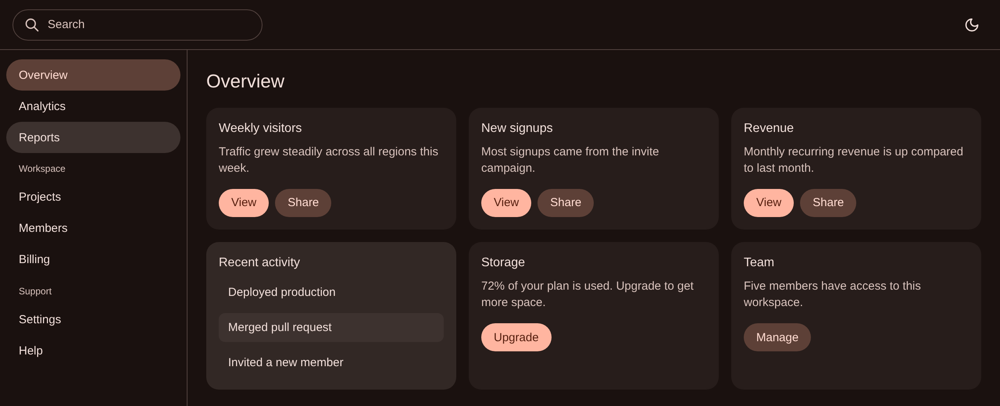
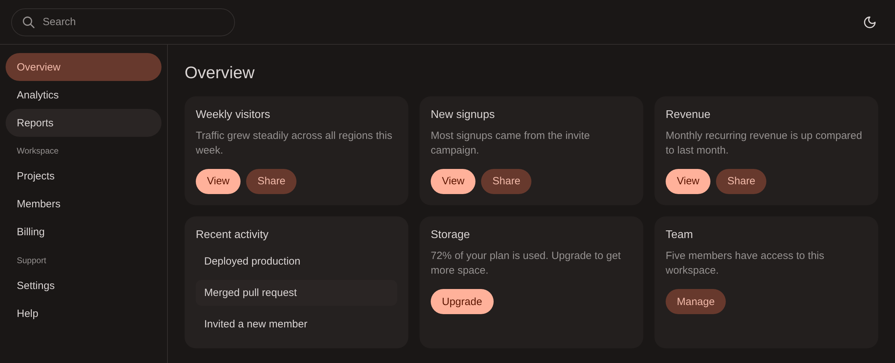

HCT (used by Material You) is computationally expensive and not natively supported in browsers.
I used OKLCH to produce visually equivalent colors, with zero dependencies.<br>
Material 3's color tokens are overwhelming. This uses shadcn's small set instead.<br>
Material 3 also looks too colorful. This is calmer.<br>
I'm using this in a UI library, neovim/vscode themes, and userscripts.

**HCT**


**OKLCH (this)**


## Installation

```
bun add m3-oklch
```

## Usage

```ts
import { hexToHct, createDynamicPalette } from 'm3-oklch'

const sourceColor = hexToHct('#ff5722')
const palette = createDynamicPalette(sourceColor, true) // Dark mode

console.log(palette) // MaterialPalette
```

Output

```ts
export type MaterialPalette = {
  foreground: string
  mutedForeground: string

  background: string

  /** Elevated panel */
  card: string

  /** Dialog, dropdown */
  popover: string

  /** Hover, selected */
  hover: string

  /** Input border, divider */
  border: string

  /** Button, link */
  primary: string
  primaryForeground: string

  /** Tonal button, tooltip */
  secondary: string
  secondaryForeground: string
}
```
